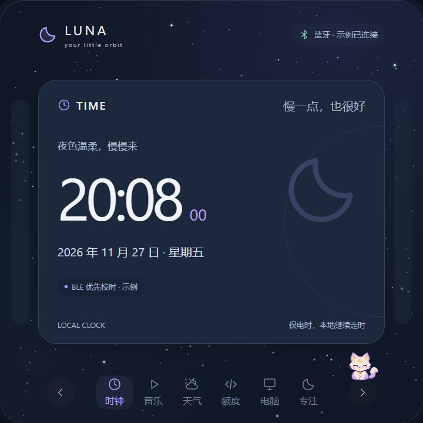
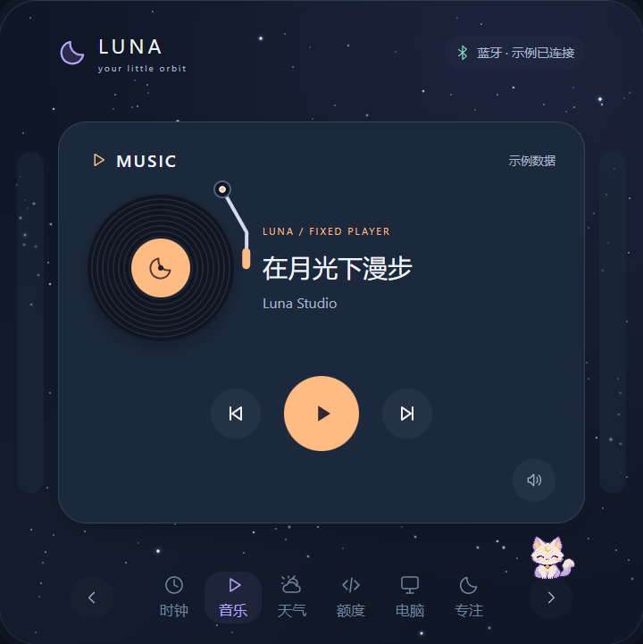
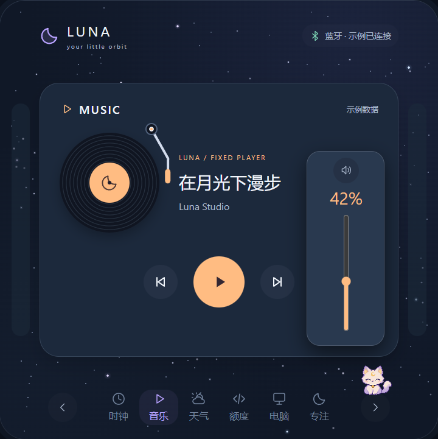
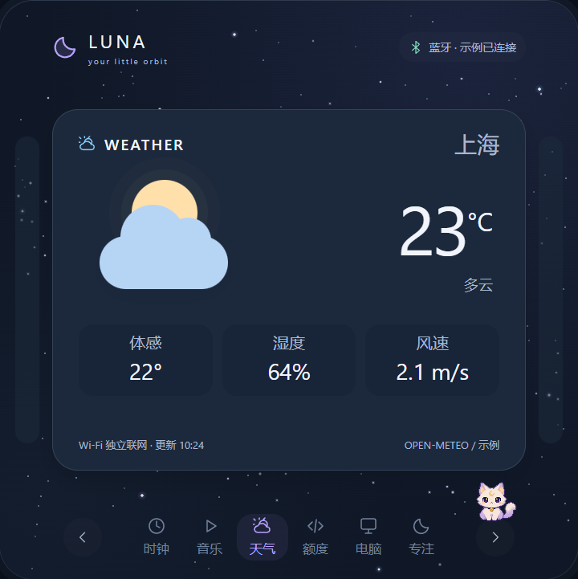
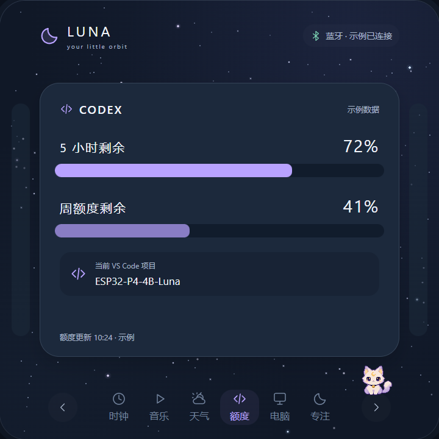
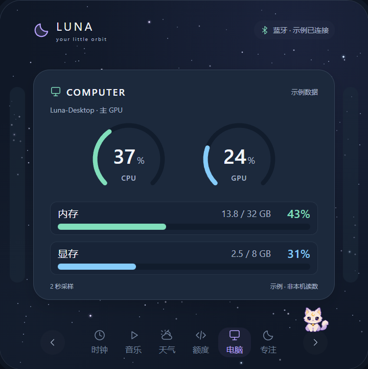
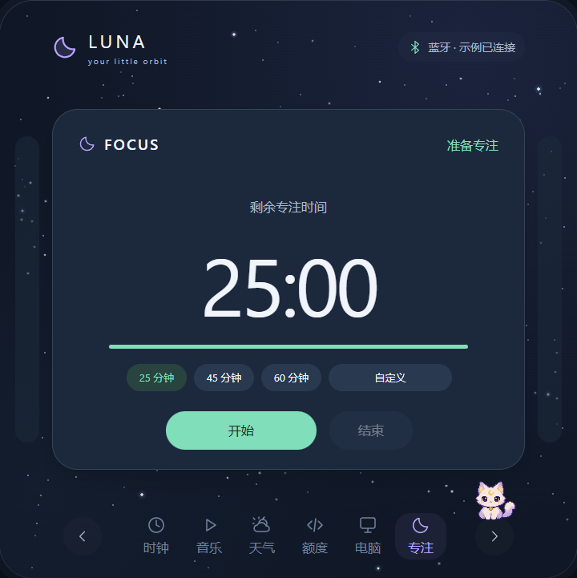
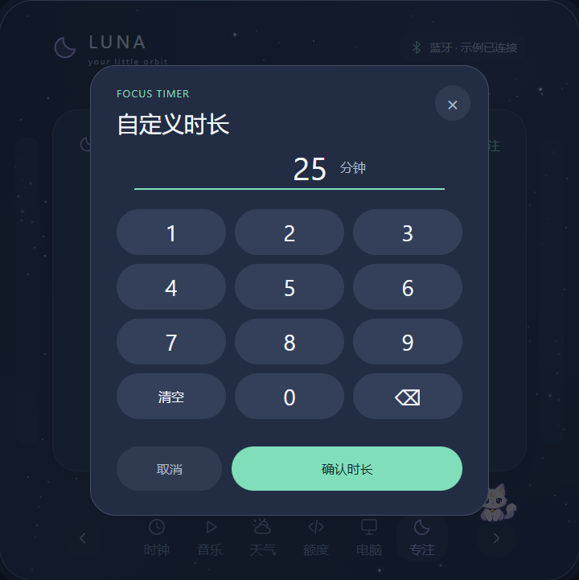
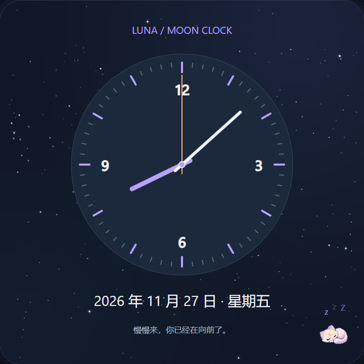

# Luna · A desktop companion under the stars

**2026.11.28 release** · [中文](README.md) · **English** · [Quick start](docs/HUB-QUICKSTART.md) · [Download release](https://github.com/2823700739-sudo/ESP32-P4-4B-Luna/releases/tag/v2026.11.28)

Luna is a wireless desktop companion for the ESP32-P4-WIFI6-Touch-LCD-4B. Its 720×720 touchscreen offers six swipeable cards: time, music, weather, Codex quota, PC metrics and Focus. A starfield and an interactive roaming pixel cat accompany your desk.

Clock, weather and Focus can work without a PC Agent. Configure 2.4 GHz Wi-Fi and a weather location from your phone; the Windows Agent adds music/system-volume controls, PC/workspace metrics and Codex quota over authenticated encrypted BLE.

This release adds the Computer B layout, corrected CPU collection, Chinese BLE pairing/recovery dialogs and background Wi-Fi reconnection. It retains the large-digit Focus layout, green K2 numeric keypad, custom 1–999-minute sessions, phone Wi-Fi rows and connection/save feedback, full-screen setup dialogs and a music tonearm. **Distribution: 2026.11.28; embedded app: 2026.11.28-computer.** The firmware is the user-approved deployed build, without recompiling to rename it. Illustrations are website previews with demo data, not hardware photos. The device UI is Chinese and the timezone is UTC+8.

## Screens and features

### Clock · Time at a glance

The default digital clock shows the date and time. BLE time synchronization takes priority, with NTP available as a network fallback. The current timezone is Beijing time (UTC+8).



### Music · Controls within reach

View the active media session's title, artist and playback state. Play, pause, previous and next use Windows GSMTC; the player must expose a supported system media session.



### Volume · Windows system audio

The right-side volume button opens a vertical slider with mute at the top. Tap outside to close it. Playback and volume commands travel over secure BLE; uncertain commands are never replayed after reconnection.



### Weather · Fetched by the device

The device retrieves weather over Wi-Fi/HTTPS and retains a local cache; Windows does not forward it. **Public binaries contain no personal Wi-Fi credentials.** After flashing, connect a phone to the device hotspot, scan for networks, enter the password and select a city or enter explicit coordinates before saving. This illustration shows demo weather.



### Codex and workspace · Your work at a glance

See remaining five-hour and weekly quota alongside the most recent foreground VS Code workspace name. Quota comes from the local Codex App Server; the workspace comes from its window title. Missing sources stay unknown, and source files and full paths are not transmitted.



### PC metrics · The essentials

Two open rings show CPU and GPU usage, with larger labels and bars for RAM and dedicated VRAM. The Windows Agent uses system APIs and a total Processor Utility counter for CPU; missing readings stay unknown. Unimplemented temperature placeholders are removed, and no additional monitoring driver is required.



### Focus · Make room for one task

Choose 25 / 45 / 60 minutes, or custom **1–999 minutes** using the green rounded keypad. Editing blocks background cards and gestures. Start/pause/resume/end work locally; running prevents clock standby across cards, while pausing allows it. The existing roaming cat gives the completion reminder. Session state resets after reboot. See the [Focus guide](docs/FOCUS.md).

 

### Standby and the pixel cat · Quiet company

When Focus is not running, after three minutes without input or a tap on the available blank area above the card, Luna switches to an analog clock, sleeping cat, floating ZZZ and a warm sentence. The first touch only wakes the previous card. In normal use, the cat blinks, wanders and responds to taps.



## Hardware and technology

| Item | Supported baseline |
| --- | --- |
| Board | Waveshare ESP32-P4-WIFI6-Touch-LCD-4B, 720×720; this image targets P4 rev1.x and retains the existing onboard C6 controller |
| Power and display | Always-on DC power; 360 MHz CPU, DOUBLE_DIRECT double buffering, no automatic standby dimming |
| Firmware | C / FreeRTOS, ESP-IDF 6.0.2, LVGL 9.3.0, ESP-Hosted 2.12.11 |
| PC | Windows 11 (build ≥ 22000), Bluetooth adapter, Python 3.11 |
| Data interfaces | GSMTC, Core Audio, Win32, DXGI / PDH, local Codex App Server, Open-Meteo HTTPS |

The product focuses on Windows BLE and device Wi-Fi. There is no macOS/Linux Agent, voice, microphone, album-cover or USB OTG product feature. UI assets are built in rather than loaded from TF storage.

## Download and deploy

1. Read the [deployment guide](docs/DEPLOYMENT.en.md) and check your board, silicon revision and existing partition layout.
2. For a first installation, download the [merged binary](firmware/releases/2026.11.28/luna-first-install-0x0.bin), verify SHA-256 and flash it at `0x0` using the guide. Existing Luna devices use app-only upgrades.
3. Connect a phone to Luna's setup hotspot and open `http://192.168.4.1` to scan/connect Wi-Fi and set the weather location. For PC features, pair Luna in Windows, install Python 3.11 x64 and run **Start-Luna.cmd**.

[First-install merged binary · 0x0](firmware/releases/2026.11.28/luna-first-install-0x0.bin) · [App binary](firmware/releases/2026.11.28/luna-panel.bin) · [Bootloader](firmware/releases/2026.11.28/bootloader.bin) · [Partition table](firmware/releases/2026.11.28/partition-table.bin) · [Checksums](firmware/releases/2026.11.28/SHA256SUMS.txt)

[Download this version as a source + binaries ZIP](https://github.com/2823700739-sudo/ESP32-P4-4B-Luna/archive/refs/heads/main.zip). The source is also available through GitHub **Code → Download ZIP**, or by cloning this version:

```powershell
git clone --depth 1 --branch main https://github.com/2823700739-sudo/ESP32-P4-4B-Luna.git
```

Separate binary distributions must also include [LICENSE](LICENSE), [NOTICE](NOTICE), [third-party notices](THIRD_PARTY_NOTICES.md) and the complete [LICENSES/](LICENSES/) directory.

**The merged file is for first installation only and clears NVS, bonds and weather cache.** Use app-only for data-preserving upgrades. It contains only P4 firmware and requires an already compatible onboard C6; P4 rev1.x / 32 MB restrictions still apply.

## Source and documentation

```text
firmware/luna-panel/                 ESP-IDF firmware and built-in assets
firmware/releases/2026.11.28/ Credential-free binaries and manifest
pc-agent/                           Windows BLE Agent
scripts/                            Build, preview and maintenance tools
docs/design/preview/                Existing interactive website preview
docs/images/                        Product illustrations
```

- [Deployment guide](docs/DEPLOYMENT.en.md) / [部署教程](docs/DEPLOYMENT.md): flashing, pairing, setup, builds and troubleshooting.
- [Development guide (Chinese)](docs/DEVELOPMENT.md): architecture, modules and protocol.
- [Documentation index](docs/README.md): public documents and asset provenance.

This version excludes local credentials, runtime logs, virtual environments, toolchains, device NVS/bonds/TF data and internal test journals. Regression test source and CI remain available for maintenance.

## Current limitations and licensing

The timezone is fixed to UTC+8. Weather needs 2.4 GHz Wi-Fi, DNS/NTP and Open-Meteo HTTPS. PC features require compatible Windows media/Codex sources. Focus is RAM-only and resets after reboot. The release is user-approved; full-duration timing, fresh merged installation, newly saved setup power-cycle and long-run checks were not individually recorded. See the [firmware manifest](firmware/releases/2026.11.28/manifest.json).

Luna-owned code and documentation use [Apache License 2.0](LICENSE); explicit alternative per-file notices remain in effect. Third-party dependencies and derived Noto fonts retain their own terms. See the bilingual [third-party notices](THIRD_PARTY_NOTICES.md), [NOTICE](NOTICE) and [complete texts/version manifest](LICENSES/manifest.json). [Firmware assets](firmware/luna-panel/main/assets/README.md) and [pixel-cat provenance](docs/design/preview/assets/README.md) document their sources and conversion.
