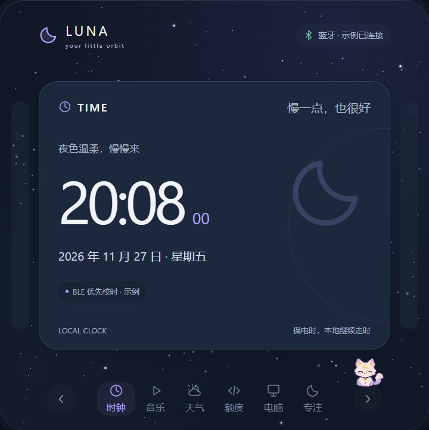
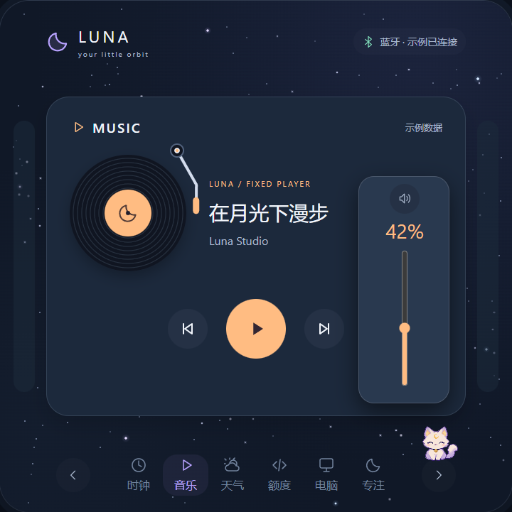
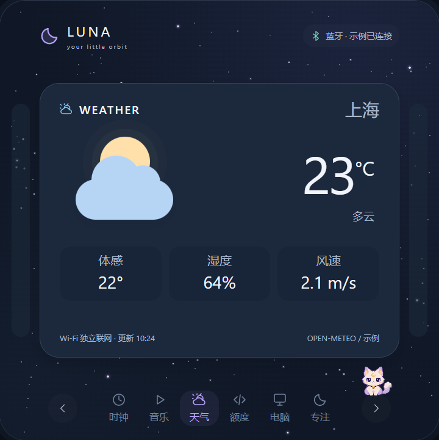
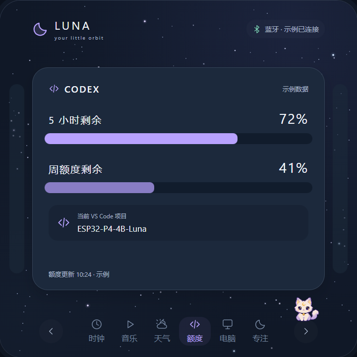
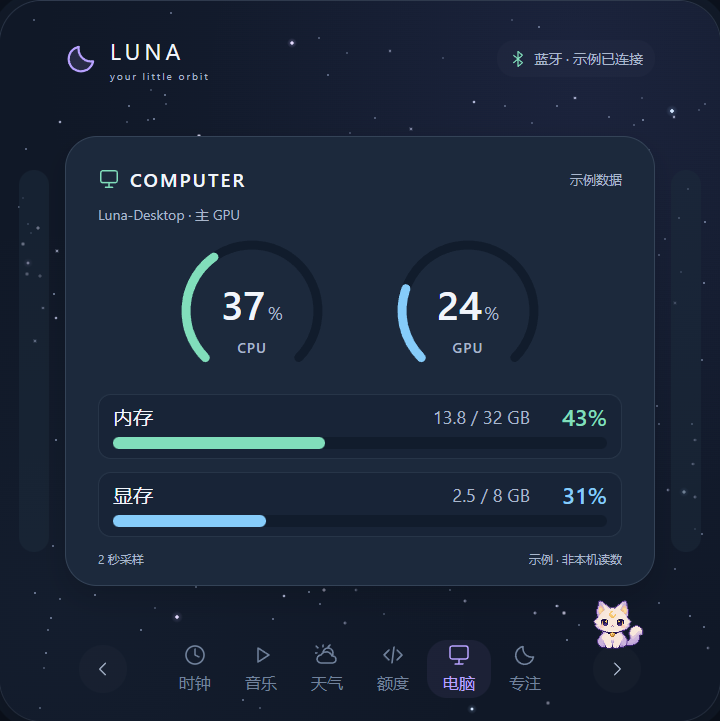
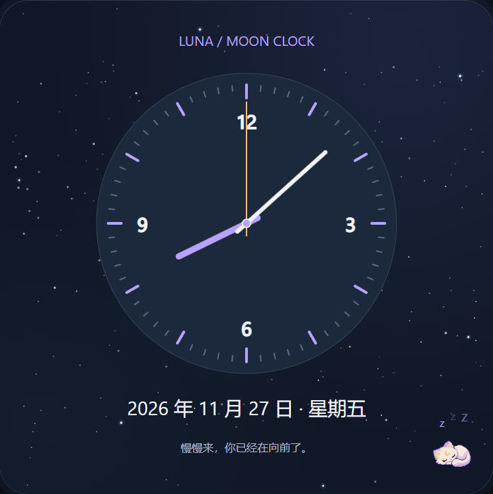

# Luna · 繁星与像素猫的桌面伙伴

**2026.11.28 定版** · **中文** · [English](README.en.md) · [快速部署](docs/HUB-QUICKSTART.md) · [下载本版](https://github.com/2823700739-sudo/ESP32-P4-4B-Luna/releases/tag/v2026.11.28)

Luna 是运行在 ESP32-P4-WIFI6-Touch-LCD-4B 上的无线桌面伙伴。720×720 触屏上有六张横滑卡片：时间、音乐、天气、Codex 额度、电脑状态和专注计时；繁星与可互动的行走像素猫，陪你工作和休息。

**时钟、天气、专注不需要电脑 Agent。** 用手机连接设备热点，设置 2.4 GHz Wi-Fi 和天气地点；Windows Agent 通过加密认证 BLE 提供音乐、系统音量、电脑/工程状态与 Codex 额度。设备 DC 常亮供电。

本版更新 B 版电脑卡与 CPU 采集口径、中文蓝牙配对/恢复弹窗和 Wi-Fi 后台重连，并保留大数字专注、绿色 K2 自定义键盘（1–999 分钟）、Wi-Fi 逐行列表和连接/保存反馈、全屏配置模态，以及音乐唱针。**分发版本 2026.11.28，应用内版本 2026.11.28-computer**，沿用用户确认的已部署固件，不为改名重新编译。本文界面图来自项目网站预览，使用示例数据，非实机照片；设备当前为中文界面、北京时间。

## 产品界面与功能

### 时钟 · 抬眼就能看见时间

默认数字时钟，显示日期与时间。电脑 BLE 校时优先，联网后可使用备用 NTP；当前时区为北京时间。



### 音乐 · 让控制留在桌面

显示当前媒体会话的标题、歌手与播放状态，支持播放、暂停、上一首和下一首。使用 Windows GSMTC，具体播放器需要支持系统媒体会话。


### 音量 · 调节整个 Windows 系统

点击右侧音量按钮打开竖向滑条，顶部按钮切换静音；点击条外关闭。播放与音量动作通过安全 BLE 传递，不确定的动作不会在断线重连后重放。



### 天气 · 由设备独立获取

天气由设备通过 Wi-Fi / HTTPS 获取，并保留本地缓存，不由 Windows Agent 转发。**公开 bin 不包含个人 Wi-Fi 凭据**；烧录后用手机连接设备热点，在网页扫描网络、输入密码，选择城市或手填经纬度并保存。下图展示预览中的示例天气。



### Codex 与工程 · 看见工作状态

显示五小时、每周剩余额度，以及最近前台 VS Code 工程名称。额度读取本机 Codex App Server，工程名称来自窗口标题；缺少来源时显示未知，不读取源文件或传输完整路径。



### 电脑状态 · 主要指标一眼可见

CPU / GPU 双开口圆环，内存 / 专用显存使用更大的文字与进度条。Windows Agent 使用系统 API 采集，CPU 采用处理器效用计数，缺失指标保持未知；移除未接入采集器的温度占位，不需要安装额外监控驱动。



### 专注 · 把这一刻留给一件事

选择 25／45／60 分钟，或通过绿色圆角数字键盘输入 **1–999 分钟**。设置时长时，其他卡片与滑动被屏蔽；开始、暂停、继续、结束均在本机完成。运行时保持唤醒，暂停后允许时钟待机，到时由原有行走小猫提醒。计时状态不跨重启保存，详见[专注卡说明](docs/FOCUS.md)。

 

### 待机与像素猫 · 安静陪伴

专注未运行时，三分钟无操作或点击卡片上方的可用空白，切换为三针时钟、睡猫、上浮 ZZZ 与暖心话。首次触摸只唤醒回原卡。正常界面中，小猫会眨眼、走动并回应点击。



## 硬件与技术

| 项目 | 当前支持 |
| --- | --- |
| 硬件 | Waveshare ESP32-P4-WIFI6-Touch-LCD-4B，720×720；当前镜像面向 P4 rev1.x，沿用板载 C6 无线控制器 |
| 供电 | DC 常亮；CPU 360 MHz，DOUBLE_DIRECT 双缓冲，待机不自动调暗 |
| 固件 | C / FreeRTOS、ESP-IDF 6.0.2、LVGL 9.3.0、ESP-Hosted 2.12.11 |
| 电脑 | Windows 11（build ≥ 22000）、蓝牙适配器、Python 3.11 |
| 数据接口 | GSMTC、Core Audio、Win32、DXGI / PDH、本地 Codex App Server、Open-Meteo HTTPS |

项目聚焦 Windows BLE 与设备 Wi-Fi；没有 macOS/Linux Agent、语音、麦克风、封面或 USB OTG 产品功能。TF 卡不承担当前 UI 素材加载。

## 下载与部署

1. 阅读[部署教程](docs/DEPLOYMENT.md)，核对板型、芯片版本与设备现有分区。
2. 首次安装下载[合并固件](firmware/releases/2026.11.28/luna-first-install-0x0.bin)，按教程从 `0x0` 烧录并核对 SHA-256；已有 Luna 使用 app-only 升级。
3. 手机连接 Luna 设置热点，打开 `http://192.168.4.1`，扫描 Wi-Fi、连接并设置天气地点。需要电脑相关功能时，再在 Windows 配对 Luna、安装 Python 3.11 x64 并运行 **Start-Luna.cmd**。

[首次安装合并 bin · 0x0](firmware/releases/2026.11.28/luna-first-install-0x0.bin) · [固件 app bin](firmware/releases/2026.11.28/luna-panel.bin) · [bootloader bin](firmware/releases/2026.11.28/bootloader.bin) · [分区表 bin](firmware/releases/2026.11.28/partition-table.bin) · [校验值](firmware/releases/2026.11.28/SHA256SUMS.txt)

[下载本版完整源码、bin 与许可 ZIP](https://github.com/2823700739-sudo/ESP32-P4-4B-Luna/archive/refs/heads/main.zip)。单独分发 bin 时请同时附带 [LICENSE](LICENSE)、[NOTICE](NOTICE)、[第三方说明](THIRD_PARTY_NOTICES.md)和完整 [LICENSES](LICENSES/) 目录。源代码也可通过 GitHub 的 **Code → Download ZIP** 获取，或克隆本版：

```powershell
git clone --depth 1 --branch main https://github.com/2823700739-sudo/ESP32-P4-4B-Luna.git
```

**合并包仅用于首次安装，会清除 NVS、配对和天气缓存；不能用于保留数据的升级。** 只包含 P4，要求板载 C6 已有兼容固件；P4 rev1.x / 32 MB 限制仍适用。

## 源代码与文档

```text
firmware/luna-panel/                 ESP-IDF 固件和内置资源
firmware/releases/2026.11.28/ 公开无凭据 bin、清单与校验值
pc-agent/                           Windows BLE Agent
scripts/                            构建、预览与维护工具
docs/design/preview/                原有网站交互预览
docs/images/                        产品界面图
```

- [部署教程](docs/DEPLOYMENT.md) / [Deployment guide](docs/DEPLOYMENT.en.md)：安装、刷写、配对、构建和排障。
- [固件广场上传材料说明](docs/HUB-PUBLISH.md)：固件、Windows 包、宣传图与简介。
- [开发文档](docs/DEVELOPMENT.md)：架构、模块职责与协议。
- [文档索引](docs/README.md)：公开文档与素材来源。

公开版本不包含本地凭据、运行日志、虚拟环境、工具链、设备 NVS/绑定/TF 数据或内部测试流水。当前源码仍保留必要的回归测试与 CI，便于后续维护。

## 当前限制与许可

时区固定北京时间；天气需要可用的 2.4 GHz Wi-Fi、DNS/NTP 与 Open-Meteo HTTPS。Codex 额度源、VS Code 窗口标题及 GSMTC 播放器兼容性会影响电脑功能。专注状态重启后重置。本版已由用户确认定版，完整时长计时、新合并首装、新保存配置的断电恢复及长期运行未逐项记录，详见[固件清单](firmware/releases/2026.11.28/manifest.json)。

Luna 自有代码与文档采用 [Apache License 2.0](LICENSE)，有明确其他许可头的文件沿用原许可。第三方组件与 Noto 派生字库保留各自授权，详见[中英第三方许可与致谢](THIRD_PARTY_NOTICES.md)、[版权通知](NOTICE)及[完整原文与版本清单](LICENSES/manifest.json)。[固件素材说明](firmware/luna-panel/main/assets/README.md)与[像素猫来源](docs/design/preview/assets/README.md)保留转换和来源记录。
